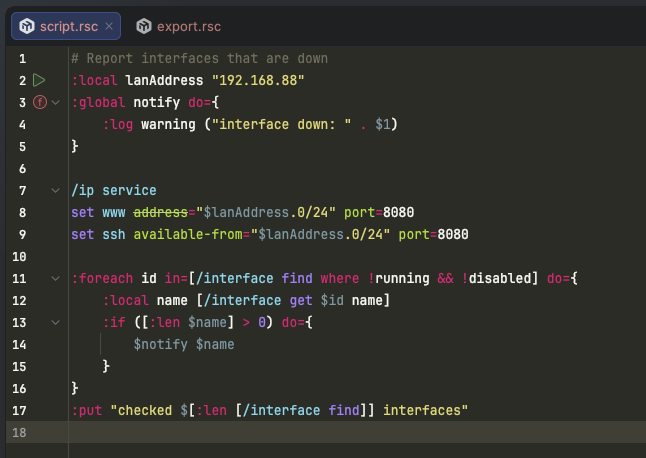
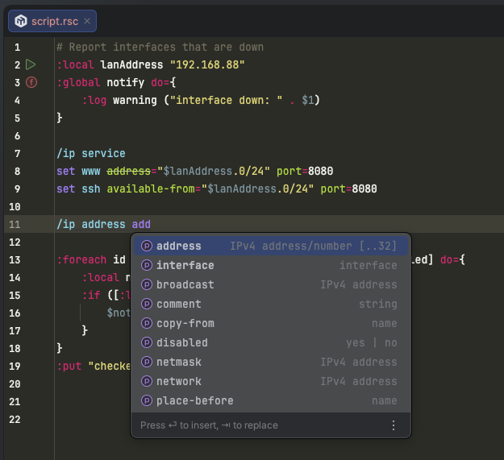
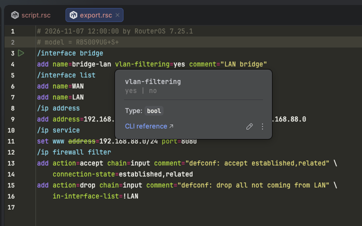
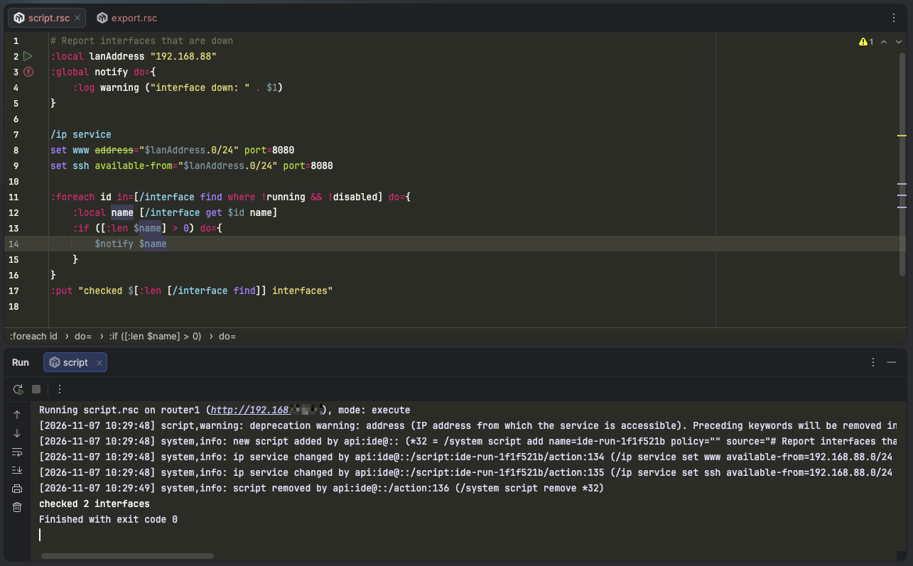
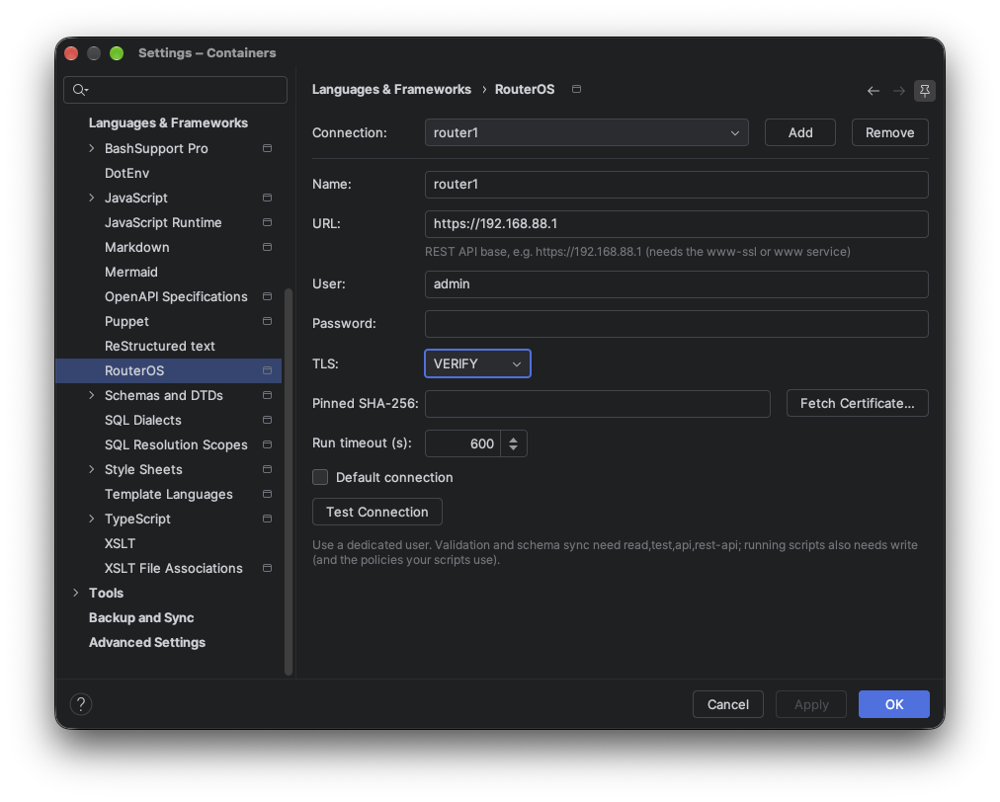

# RouterOS Script for JetBrains IDEs

Language support for MikroTik RouterOS scripts and `/export` configuration
files (`.rsc`) in IntelliJ IDEA, PyCharm and every other JetBrains IDE based on
IntelliJ Platform 2025.1 or newer.

<!-- Plugin description -->
Language support for **MikroTik RouterOS** scripts and `/export` configuration
files (`.rsc`).

- Syntax highlighting for scripts and exports (RouterOS v7, v6 best-effort): menu paths,
  properties, values, script commands, variables, string escapes and interpolation
- Configurable colours (*Settings → Editor → Color Scheme → RouterOS Script*)
- Brace matching, `#` line comments (Ctrl+/), quote handling, TODO highlighting
- Structure view with export sections, functions and globals; breadcrumbs; code folding
- RouterOS highlighting inside script strings (`/system script add source="…"`, scheduler
  `on-event`, netwatch/DHCP/PPP script properties)
- Completion for menu paths, commands, properties (`name=`), values (enums, yes/no,
  interface names from the file), `:` commands and variables in scope
- Command reference for every MikroTik release channel — stable, long-term and development —
  picked automatically from the connected router or chosen in the settings
- Quick documentation (Ctrl+Q) from the official CLI reference, parameter info (Ctrl+P)
- Go to declaration, find usages and rename for variables and functions (`:global` across files),
  Go to Symbol, gutter icons on functions
- Inspections with quick fixes: undefined/undeclared variables, unused locals, unknown properties
  (did you mean), wrong values, v6 syntax, missing mandatory properties, whitespace before `=`,
  invalid names, `{}` arrays, missing `do=`, unreachable code, misplaced comments
- Intentions: space ⇄ slash menu paths, quote/unquote values, wrap in `:do { } on-error={ }`
- Formatter (flat export style by default, optional section indent), code style settings,
  56 live templates, *New → RouterOS Script*, surround with, spell checking in comments/strings
- Router integration over the REST API: run configurations (execute, upload & run, import)
  with clickable errors and live log, validate with the router's parser, open/compare
  `/export`, schema sync from the router, log tool window — see the
  [device integration guide](https://github.com/DyBuGroup/intellij-routeros/blob/main/docs/device-integration.md)
- Experimental pseudo-debugger (opt-in): breakpoints, stepping and variables through an
  instrumented copy of the script
- Works fully offline; no router required for editing features
<!-- Plugin description end -->

## Installation

**From the beta channel** (until the first stable release):

1. *Settings → Plugins → ⚙ → Manage Plugin Repositories…* → add
   `https://plugins.jetbrains.com/plugins/beta/list`.
2. Search the Marketplace tab for **RouterOS Script** and install it.

**From a file:** download the zip from
[GitHub Releases](https://github.com/DyBuGroup/intellij-routeros/releases) (or build it, see
[CONTRIBUTING.md](CONTRIBUTING.md)) and use *Settings → Plugins → ⚙ → Install Plugin from Disk…*.

## Screenshots

## RouterOS versions

The plugin bundles the command reference of MikroTik's **stable**, **long-term** and
**development** release channels (currently RouterOS 7.25, 7.24 and 7.26). *Settings → Languages &
Frameworks → RouterOS → RouterOS version* chooses one, or *Automatic* follows the connected router.
A monthly workflow regenerates the schemas when MikroTik publishes new releases.

## Documentation

- [Device integration](docs/device-integration.md) — connections, running, validation, debugger
- [Schema](docs/schema.md) — where completion data comes from and how it is regenerated
- [Architecture](docs/architecture.md) — for contributors

## Security

Please report vulnerabilities privately; see [SECURITY.md](SECURITY.md).

## License

[Apache License 2.0](LICENSE). See [NOTICE](NOTICE) and [THIRD-PARTY-NOTICES.md](THIRD-PARTY-NOTICES.md).
